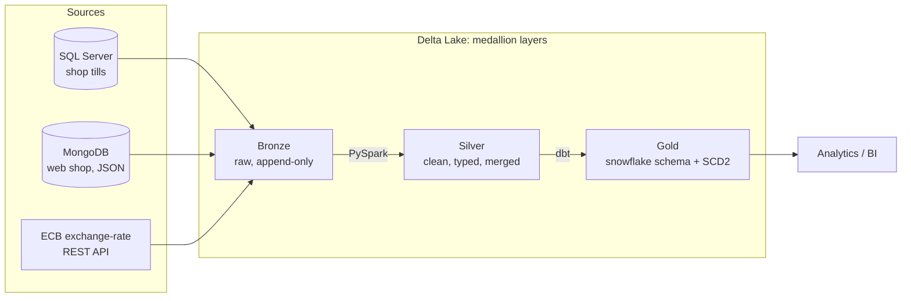
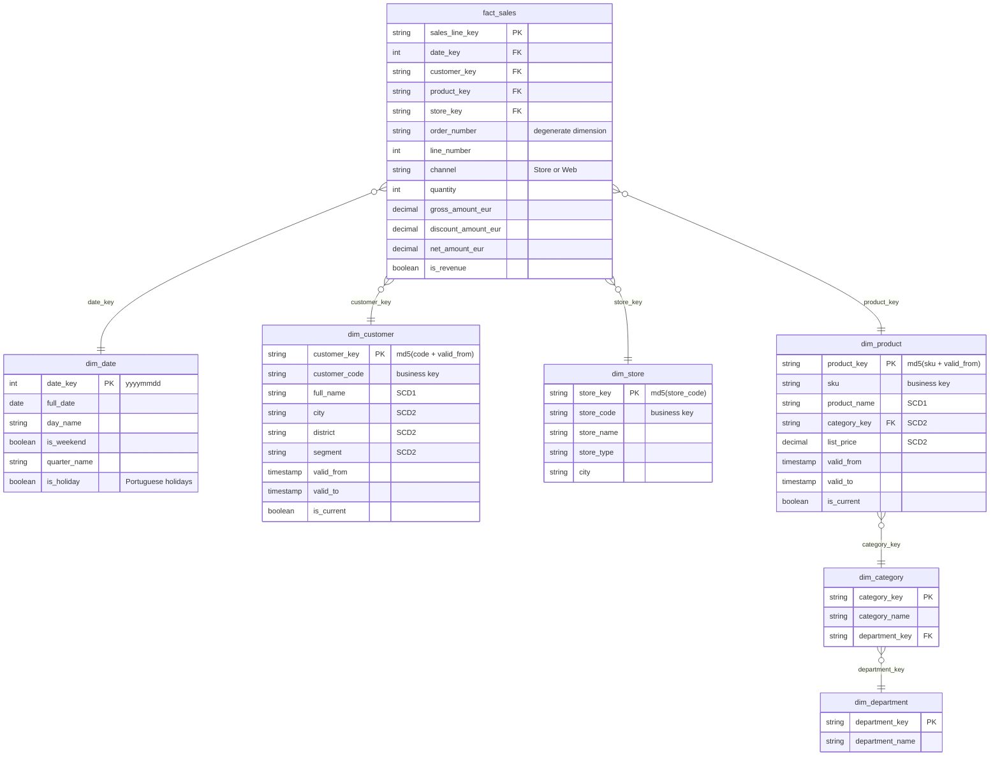
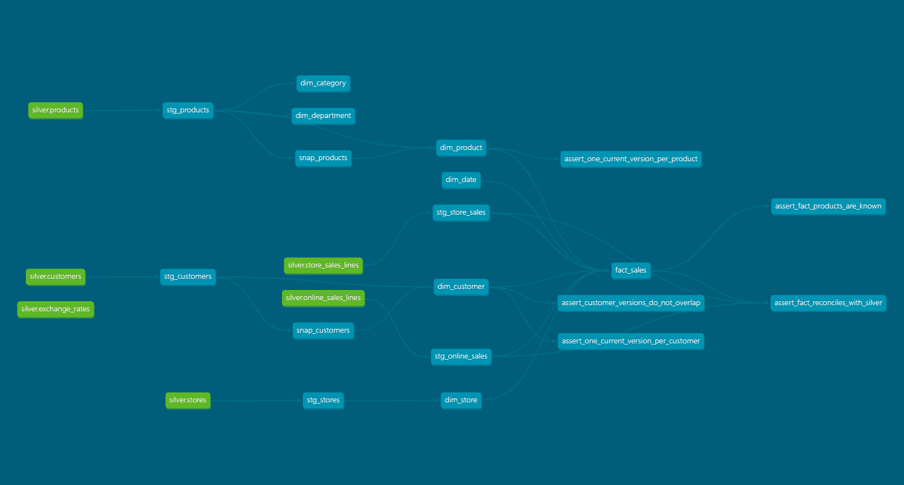
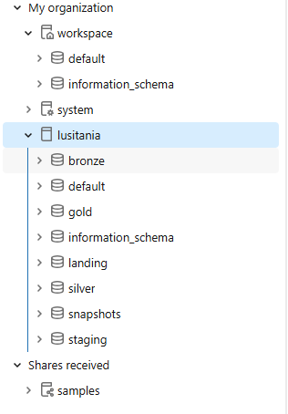

# Lusitânia Stores: a lakehouse with PySpark, Delta Lake, dbt and Databricks

The same retail business as [Project 1](https://github.com/JNFernandes/lusitania-bi-data-warehouse), rebuilt as a **medallion lakehouse**. Three source types (relational, NoSQL, REST API) land in bronze, are cleaned with PySpark into silver Delta tables, and are modelled with dbt into a gold **snowflake schema** with SCD Type 2 history. The pipeline runs on a laptop (Spark + DuckDB) and in the cloud on **Databricks with Unity Catalog**, from the same code.

<p>
  <a href="https://github.com/JNFernandes/lusitania-lakehouse/actions/workflows/ci.yml"></a>
  
  
  
  
  
  
  
  
</p>

---

## What this project shows

| | |
|---|---|
| **Three source types** | SQL Server (relational tills), MongoDB (nested JSON web orders), a REST API (ECB exchange rates) |
| **Medallion architecture** | Bronze (raw, append-only) → Silver (clean, merged) → Gold (dimensional model) |
| **Spark + Delta Lake** | PySpark transformations, Delta `MERGE` upserts, ACID tables, time travel |
| **dbt** | Staging views, SCD Type 2 snapshots, a snowflake schema, 64 data tests, lineage docs |
| **Two platforms, one codebase** | Runs on a laptop (Spark + DuckDB) and on Databricks with Unity Catalog |
| **Software engineering** | Installable Python package, a CLI, logging, 43 pytest tests, lint, GitHub Actions CI |

---

## Architecture



| Layer | Built with | Contents |
|---|---|---|
| **Bronze** | Python + PySpark | 9 Delta tables, an exact copy of each source; every batch kept, with `_batch_id`, `_ingested_at`, `_source` |
| **Silver** | PySpark + Delta `MERGE` | 6 clean tables: customers, products, stores, daily exchange rates, store sales lines, web sales lines (in EUR) |
| **Gold** | dbt | 2 snapshots (SCD2), 6 dimensions, `fact_sales`; 64 automated tests |

---

## Data model (gold): a snowflake schema

Chosen deliberately, to compare with the star schema of [Project 1](https://github.com/JNFernandes/lusitania-bi-data-warehouse). The product dimension is **normalised** into three tables: product → category → department.



- **`fact_sales`**: grain = one row per order line, **both channels** (99,883 in-store lines from SQL Server + 20,155 web lines from MongoDB), all amounts in EUR.
- **`dim_customer`**: SCD2 on city, district and segment; name and contact details are always current (SCD1).
- **`dim_product`**: SCD2 on category and list price; points to `dim_category`, which points to `dim_department`.
- **`dim_store`**: the physical stores plus a `WEB` row for the online shop.
- Every dimension has an **Unknown member (`-1`)**, so walk-in and guest sales never get lost in a join.

**Star vs snowflake, the trade-off:** renaming a category changes one row in `dim_category`, instead of every product row in it (and, with SCD2, a new version of each). The cost is that reaching a department takes three joins instead of one.

### Lineage (generated by dbt)



### Unity Catalog on Databricks



`lusitania` catalog → `landing` (volume with raw files) → `bronze` → `silver` → `staging` (views) → `snapshots` (SCD2) → `gold`.

---

## Design decisions

**Medallion layers with different jobs.**
Bronze keeps every batch exactly as received, so silver and gold can always be rebuilt. Silver holds the *clean current state*. History (SCD2) is built only in gold, by dbt snapshots.

**Raw JSON kept as text in bronze.**
MongoDB documents vary from order to order (guest checkouts, missing payment). Storing each document as one JSON string means bronze never breaks on a new field; the schema is applied in silver.

**Data problems fixed in silver, on purpose.**
The generated web orders contain about 1.5% duplicates, three date formats, lowercase SKUs, guest checkouts and missing payment methods. Silver parses every date format, keeps the latest version of each duplicate (window function), `explode`s the nested items to order-line grain and standardises codes: 8,120 documents → 8,000 orders → 20,155 lines.

**Currency conversion at the order's own date.**
The ECB publishes rates on working days only. Silver builds a full daily calendar and fills weekends and holidays with the previous working day's rate, so every GBP and USD order converts with the rate valid on its date.

**Business keys across sources.**
Silver replaces SQL Server's internal IDs with business keys (`store_code`, `customer_code`, `sku`): the only keys the SQL Server and MongoDB data share.

**Idempotent at every layer.**
Bronze on Databricks skips a batch already loaded; silver uses Delta `MERGE` and updates only rows that really changed (null-safe `<=>` comparison); gold is rebuilt deterministically. Running the pipeline twice changes nothing.

**Hash surrogate keys.**
Gold keys are `md5` of the business key (plus the version start for SCD2). Because dbt rebuilds tables, a hash gives the same key on every run, unlike an `IDENTITY` counter.

**Point-in-time lookups.**
Each fact line joins the customer and product version where `valid_from ≤ order_ts < valid_to`, so a 2025 sale stays with the customer's 2025 city after they move.

**One Python package, two platforms.**
The silver code never names a folder or a table: it asks a `Lakehouse` object for `("silver", "customers")`. `LocalLakehouse` answers with the Delta folder `data/silver/customers`; `CatalogLakehouse` with the Unity Catalog table `lusitania.silver.customers`. The Databricks notebook imports the package and passes a `CatalogLakehouse`, so there is one version of the cleaning logic, covered by the tests.

**Pure transformations, tested in isolation.**
Each silver table has a `clean()` function: DataFrames in, DataFrame out, no reading or writing inside. Unit tests build tiny DataFrames by hand (a weekend without a rate, a duplicated order, a lowercase SKU, a GBP price) and check the result, with no SQL Server, MongoDB or Delta needed.

**One dbt project, two platforms.**
The only dialect difference (date functions in `dim_date`) is handled with Jinja (``). Everything else is portable SQL.

**Known limitation: snapshot timing.**
A dbt `check` snapshot records a change when it *sees* it, not when it happened in the source, and two changes between runs become one version. In production the pipeline would run on a schedule (Databricks Jobs) to keep that gap small.

---

## Tests and CI

| Layer | What is tested | How |
|---|---|---|
| Python code | Every `clean()` function, the MERGE conditions, the CLI; the whole silver layer on an in-memory fake storage (idempotency, a failed check stops the run); the Delta MERGE on real tables | `pytest`: 43 tests |
| Silver data | Row counts vs bronze, unique and not-null keys, every date parsed, every line has an EUR price, every SKU exists | checks in each `build()`; a failure stops the pipeline |
| Gold sources | Unique / not-null keys on silver, referential integrity of SKUs | dbt generic tests |
| Gold models | Unique / not-null surrogate keys, every fact foreign key exists in its dimension, accepted values | dbt generic tests |
| Gold logic | One current version per customer and product, no overlapping SCD2 versions, **fact reconciles with silver** (same lines, same euros) | dbt singular tests |

`dbt build`: **64 / 64 passed** locally and on Databricks.
**CI:** on every push, [GitHub Actions](.github/workflows/ci.yml) runs `ruff` (lint), `pytest` and `dbt parse`.

---

## Repository structure

```
pyproject.toml              project definition: dependencies, the `lusitania` command, pytest and ruff settings
src/lusitania/              the pipeline, as an installable Python package
├── config.py               settings from .env
├── spark.py                local Spark session (Delta, Windows fixes)
├── log.py                  logging setup
├── storage.py              Lakehouse interface: LocalLakehouse (folders) / CatalogLakehouse (Unity Catalog)
├── bronze/                 sources.py (SQL Server, MongoDB, API readers) · load.py · report.py
├── silver/                 framework.py (read / merge / check) · one module per table · run.py
├── pipeline.py             bronze → silver → dbt
└── cli.py                  the `lusitania` command
tests/
├── unit/                   clean() functions, merge logic, CLI, whole silver layer on a fake storage
└── integration/            Delta MERGE on real tables in a temporary folder
dbt/                        silver → gold: staging, snapshots, marts, tests
databricks/notebooks/       01_bronze (volume → bronze) · 02_silver (imports src/lusitania)
scripts/                    tools, not pipeline: MongoDB data generator, export for Databricks, look_gold
docs/images/                screenshots for this README
.github/workflows/ci.yml    lint + tests + dbt parse on every push
```

---

## How to run

### Locally

**Requirements:** Python 3.11, Java 17, SQL Server with the Project 1 `LusitaniaOLTP` database, MongoDB Community. On Windows, Spark also needs `winutils.exe` and `hadoop.dll` with `HADOOP_HOME` set.

```powershell
py -3.11 -m venv .venv
.venv\Scripts\Activate.ps1
pip install -e ".[dev,dbt]"                       # the package + test and dbt tools
Copy-Item .env.example .env

python scripts/generate_online_orders.py         # create the web-shop data in MongoDB
lusitania run                                    # bronze → silver → dbt build
python scripts/look_gold.py                      # see the result
```

Each layer can also run on its own: `lusitania bronze`, `lusitania silver`, `lusitania gold`, `lusitania inspect`.

```powershell
pytest            # unit + integration tests
ruff check .      # style and likely bugs
```

### On Databricks

1. `python scripts/export_for_databricks.py`, then upload `data/export/*.parquet` to the volume `lusitania.landing.raw_files`.
2. Add this repository as a **Git folder** (Workspace → Create → Git folder), then run `databricks/notebooks/01_bronze` and `02_silver`.
3. Set `DATABRICKS_HOST`, `DATABRICKS_HTTP_PATH` and `DATABRICKS_TOKEN` in the terminal (never in a file), then `lusitania gold --target databricks`.

---

## How the project was built: the phases

### Phase 1: the lakehouse on a laptop (Python only)

Everything runs locally, with no cloud:

1. **Sources.** SQL Server already held the shop data from Project 1. A script generated the web orders into MongoDB, with deliberate data problems. The exchange rates come from a public API.
2. **Bronze.** PySpark reads the three sources and appends them, as received, to Delta tables in `data/bronze/`.
3. **Silver.** PySpark cleans each table and `MERGE`s it into `data/silver/`, then runs data checks.
4. **Gold.** dbt reads the silver Delta tables through **DuckDB** (a database in a single file, `data/lusitania_gold.duckdb`) and builds the snapshots, dimensions and fact, then runs 64 tests.

### Phase 2: the same pipeline on Databricks

The same layers, rebuilt in the cloud on **Unity Catalog** (`catalog.schema.table`). The laptop and Databricks are connected by three bridges:

| Bridge | Problem | Solution |
|---|---|---|
| **Data** | Databricks, in the cloud, cannot reach the SQL Server and MongoDB on the laptop | The laptop exports the latest bronze batch as Parquet files (`export_for_databricks.py`), uploaded to a Unity Catalog **volume**, a folder for files inside the catalog. `01_bronze` loads them into `lusitania.bronze` |
| **Code** | The silver logic must not be written twice | The repository is linked to Databricks as a **Git folder**; `02_silver` imports `src/lusitania` and passes a `CatalogLakehouse` |
| **Compute (dbt)** | dbt runs on the laptop, but gold must be built in Databricks | The `databricks` target in `profiles.yml` uses the `dbt-databricks` adapter. dbt connects to a **serverless SQL warehouse** with a personal access token and sends it the SQL; Databricks does the work and writes `lusitania.snapshots`, `staging` and `gold` |


### What dbt does here

**dbt (data build tool)** is the **T in ELT**: it transforms data that is already inside a database. It does not move or load data. You write each table as a `SELECT` in a `.sql` file, and dbt:

- **builds them in the right order**: `{{ ref('stg_products') }}` declares a dependency, so dbt knows `dim_product` comes after `stg_products` (the lineage graph above);
- **creates the objects**: a view or a table (*materialisation*) in the right schema, without hand-written `CREATE TABLE`;
- **keeps history**: *snapshots* compare silver with the last run and record changes as SCD2 versions;
- **tests the data**: uniqueness, not-null, relationships and custom SQL tests, after every build;
- **documents**: descriptions and the lineage graph come from the same project;
- **runs anywhere**: an *adapter* translates to each database. `dbt-duckdb` on the laptop, `dbt-databricks` in the cloud, with the same models.

`dbt build` = run the snapshots, build the models and run the tests, in dependency order, stopping downstream models when a test fails.

---

## Lakehouse (Project 2) vs warehouse (Project 1)

| | Project 1: warehouse | Project 2: lakehouse |
|---|---|---|
| Storage | Inside SQL Server | Open Delta files (Parquet + transaction log) |
| Sources | SQL Server | SQL Server, MongoDB (JSON), REST API |
| Staging | Truncated every load | Bronze keeps every batch |
| Transformation | T-SQL stored procedures, SSIS | PySpark, Delta `MERGE`, dbt |
| SCD2 | Hand-written procedure with hashes | dbt snapshots |
| Schema | Star | Snowflake |
| Tests | Manual reconciliation queries | pytest + silver data checks + 64 dbt tests, run in CI |
| Platform | One server | Laptop and Databricks, same code |

---

*All data is synthetic, generated by the scripts in this repository. Exchange rates are real ECB reference rates.*
